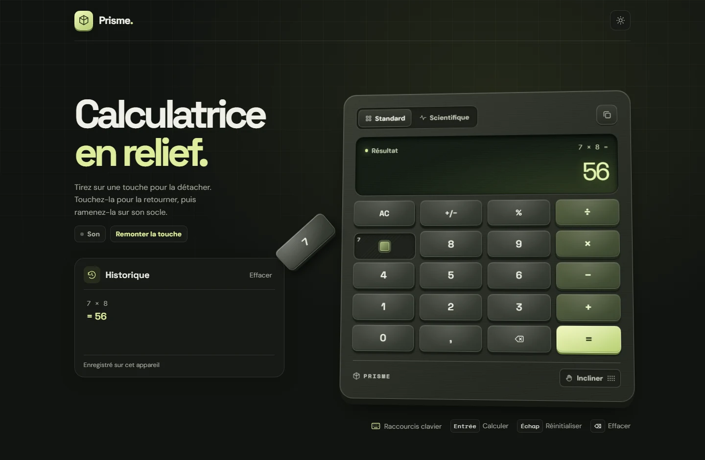
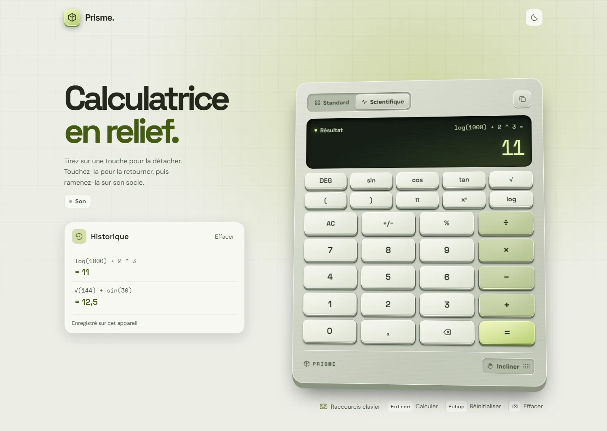

# Prisme

Prisme is a browser-based scientific calculator with a tactile 3D keypad. Keys tilt under the pointer, pop off their switches when pulled, and snap back into place. The interface is in French and works with a mouse, touch, or keyboard.

[Open the private demo](https://prisme-calculatrice.bigbush6.chatgpt.site)



## Run locally

Clone the repository with Git, or download and extract the ZIP from GitHub. A modern browser is enough to run the app.

```sh
git clone https://github.com/Aymane-Faouzi/prisme.git
cd prisme
```

Open [dist/index.html](dist/index.html) from the cloned folder in your browser. All app files are already in `dist/`.

If you have Python 3, you can also serve the app locally over HTTP. Run this from the repository root, then open [http://127.0.0.1:8000](http://127.0.0.1:8000) in your browser. On Windows, use `py -3` in place of `python3` if you installed the Python launcher. Press **Ctrl+C** to stop the server.

```sh
python3 -m http.server 8000 --bind 127.0.0.1 --directory dist
```

## Explore the 3D controls

| Action | What happens |
| --- | --- |
| Hover, click, or tap a key | Hover tilts the keycap under your pointer. Clicking or tapping presses the switch and enters the key. |
| Pull a key away from its switch | The cap detaches. Flick it to make it slide with momentum. The exposed switch still works. |
| Click or tap a loose cap | The cap flips over. Hold **Shift** while dragging it to rotate it in place. |
| Drag a cap back over its own switch | It snaps back in. Use **Remonter la touche** or **Remonter les touches** to reattach caps at once. |
| Drag **Incliner** | The case tilts and settles with momentum. Click or tap the grip to reset the angle. |
| Toggle **Son** | Enable sound effects for pressing, pulling, flipping, and snapping keys. |

For keyboard control, focus a key and press **Shift+Enter** to detach it. With a loose cap focused, press **Enter** to flip it, the **arrow keys** to rotate it, or **Esc** to reattach it. During regular calculation, **Enter** evaluates the expression, **Backspace** deletes the last character, and **Esc** clears the calculation.

## Calculate

- **Standard** supports arithmetic, parentheses via the keyboard, and percentages. For example, `200 + 10%` gives `220`.
- **Scientifique** adds visible controls for trigonometry, powers, square roots, logarithms, and π. Use **DEG** or **RAD** to switch angle units.
- **Historique** stores up to 30 results in your browser. Select a result to reuse it. The theme and sound setting are also stored locally.



## Project files

| File | Role |
| --- | --- |
| [dist/index.html](dist/index.html) and [dist/style.css](dist/style.css) | Interface, themes, and 3D styling |
| [dist/engine.js](dist/engine.js) | Expression parsing and scientific calculations |
| [dist/app.js](dist/app.js) | Calculator input, display, settings, and history |
| [dist/motion.js](dist/motion.js) | Pointer interactions, spring motion, and sound effects |
